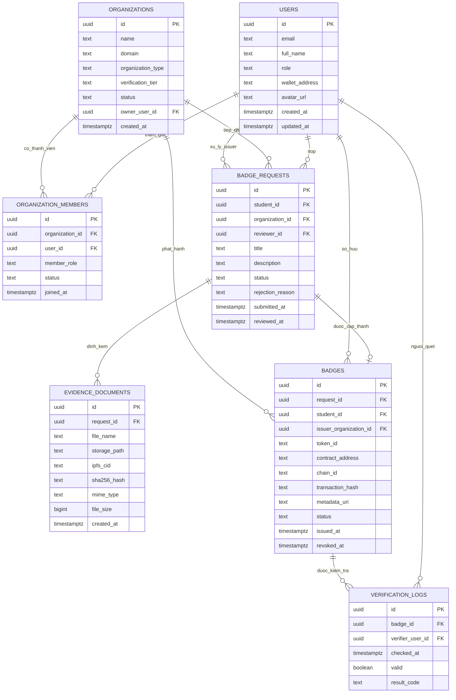

# ERD và mô tả cơ sở dữ liệu SkillPass

> Tài liệu này dựng ERD từ mô hình được mô tả trong `PROJECT_CONTEXT.md` và `docs/database_schema.md`. Repository hiện chưa có migration/DDL Supabase; vì vậy các tên bảng là theo thiết kế hiện có, còn tên/các kiểu cột cụ thể dưới đây là đề xuất hợp lý để triển khai, không khẳng định là schema đã chạy trên Supabase.

## 1. ERD tổng quan

## 2. Hướng dẫn đọc ký hiệu

- `PK` (Primary Key/khóa chính): định danh duy nhất mỗi dòng dữ liệu. UUID phù hợp với Supabase/PostgreSQL và không cần bộ đếm tuần tự.
- `FK` (Foreign Key/khóa ngoại): tham chiếu đến khóa chính của bảng khác; đây là chỗ nối giữa các thực thể.
- `||--o{` biểu thị một bản ghi ở đầu trái liên kết với không hoặc nhiều bản ghi ở đầu phải. Ví dụ một tổ chức có thể chưa có thành viên hoặc có nhiều thành viên.
- `||--o|` biểu thị một-một tùy chọn: yêu cầu có thể chưa được cấp huy hiệu; nếu đã cấp thì tối đa một huy hiệu cho yêu cầu đó (nên đặt UNIQUE trên `badges.request_id`).
- `timestamptz` lưu mốc thời gian có múi giờ; PostgreSQL thường lưu chuẩn UTC và hiển thị theo múi giờ phiên.
- Các cột trong ERD là mô hình đề xuất để diễn giải nghiệp vụ. Cần đối chiếu với DDL/migrations thực tế trước khi tạo database production.

## 3. Mô tả chi tiết từng bảng

### 3.1 `users` — tài khoản và hồ sơ người dùng

Lưu hồ sơ ứng dụng gắn với danh tính đăng nhập Supabase Auth. Bản ghi người dùng có thể là sinh viên, issuer (người đại diện đơn vị cấp), HR (người xác minh), hoặc admin theo tài liệu dự án.

| Cột | Vai trò / ý nghĩa | Quy tắc nên áp dụng |
|---|---|---|
| `id` (PK, UUID) | ID hồ sơ; nên dùng cùng giá trị `auth.users.id` để ánh xạ một-một với Supabase Auth. | PK; tạo khi đăng ký hoặc trigger đồng bộ từ Auth. |
| `email` (text) | Email liên hệ/đăng nhập đã chuẩn hóa. | UNIQUE, lowercase; không dùng riêng email làm định danh chính. |
| `full_name` (text) | Tên hiển thị của người dùng và chủ thể nhận huy hiệu. | Có thể bắt buộc khi nộp/cấp chứng nhận. |
| `role` (text/enum) | Vai trò giao diện hoặc vai trò tổng quát (`student`, `issuer`, `hr`, `admin`). | Kiểm soát quyền thật bằng RLS/quan hệ thành viên; không tin role gửi từ client. |
| `wallet_address` (text, nullable) | Ví nhận SBT trên Avalanche Fuji. | Chuẩn hóa checksum/lowercase để so sánh; UNIQUE nếu chính sách yêu cầu một ví/người. |
| `avatar_url` (text, nullable) | Ảnh hồ sơ; nên là URL/path Storage, không lưu byte ảnh trong bảng. | Có thể bỏ trống. |
| `created_at`, `updated_at` | Thời điểm tạo và cập nhật hồ sơ. | `created_at` mặc định `now()`; cập nhật `updated_at` bằng trigger. |

**Quan hệ:** một user tham gia nhiều tổ chức thông qua `organization_members`; một user có thể tạo nhiều `badge_requests`, sở hữu nhiều `badges`, xử lý nhiều yêu cầu với tư cách reviewer và phát sinh nhiều lần xác minh.

### 3.2 `organizations` — trường học, doanh nghiệp hoặc đơn vị cấp

Đại diện cho issuer. Bảng này giữ thông tin xác thực tổ chức và phân hạng uy tín ba cấp được mô tả trong dự án: Enterprise Verified, Academic Verified, Community Verified.

| Cột | Vai trò / ý nghĩa | Quy tắc nên áp dụng |
|---|---|---|
| `id` (PK, UUID) | Định danh tổ chức. | PK. |
| `name` (text) | Tên hiển thị pháp lý/thương hiệu. | Bắt buộc. |
| `domain` (text) | Miền email được phép đăng ký/đối chiếu, ví dụ tên miền trường hoặc công ty. | Chuẩn hóa bỏ `@`; có thể UNIQUE nếu một domain chỉ thuộc một tổ chức. Domain chỉ là một lớp kiểm tra, không đủ chứng minh danh tính. |
| `organization_type` (text/enum) | Loại tổ chức: doanh nghiệp, học thuật hoặc cộng đồng. | Ràng buộc bằng enum/CHECK. |
| `verification_tier` (text/enum) | Cấp xác minh hiển thị trên hồ sơ/huy hiệu. | Giá trị dự kiến: `enterprise_verified`, `academic_verified`, `community_verified`. |
| `status` (text/enum) | Trạng thái tổ chức, ví dụ `pending`, `verified`, `suspended`. | Chỉ tổ chức đủ điều kiện mới được cấp badge. |
| `owner_user_id` (FK → `users.id`) | Người khởi tạo/quản lý chính của tổ chức. | Có thể nullable nếu tổ chức được bootstrap bởi admin. |
| `created_at` | Thời điểm tạo. | Mặc định `now()`. |

**Quan hệ:** tổ chức có nhiều thành viên, nhiều yêu cầu được gửi để xác minh/cấp badge và nhiều badge đã phát hành. Bản demo chỉ dùng một ví Relayer do Admin SkillPass quản lý. Doanh nghiệp không có ví/private key riêng; `status = verified` là điều kiện để backend cho phép dùng Relayer và Admin trả gas AVAX.

### 3.3 `organization_members` — liên kết người dùng với tổ chức

Đây là bảng nối nhiều-nhiều: một tổ chức có nhiều người duyệt và một người có thể thuộc nhiều tổ chức. Vai trò ở đây có phạm vi trong tổ chức, khác với role chung của tài khoản.

| Cột | Vai trò / ý nghĩa | Quy tắc nên áp dụng |
|---|---|---|
| `id` (PK, UUID) | Định danh dòng thành viên. | PK; hoặc dùng khóa ghép `(organization_id, user_id)` nếu không cần ID độc lập. |
| `organization_id` (FK → `organizations.id`) | Tổ chức mà user tham gia. | Bắt buộc; index. |
| `user_id` (FK → `users.id`) | Tài khoản thành viên. | Bắt buộc; index. |
| `member_role` (text/enum) | Quyền trong tổ chức, ví dụ `owner`, `issuer`, `reviewer`, `viewer`. | Chỉ `issuer`/`reviewer` được duyệt theo chính sách. |
| `status` (text/enum) | Trạng thái lời mời/thành viên: `invited`, `active`, `revoked`. | Chỉ `active` được dùng quyền. |
| `joined_at` | Thời điểm tham gia/kích hoạt. | Nullable khi mới được mời. |

**Ràng buộc:** UNIQUE `(organization_id, user_id)` để tránh thêm trùng một thành viên; việc rời tổ chức nên đổi trạng thái/ghi lịch sử thay vì xóa nếu cần audit.

### 3.4 `badge_requests` — đơn yêu cầu cấp chứng nhận

Đây là hồ sơ quy trình nghiệp vụ trung tâm: sinh viên gửi thông tin thành tích/kỹ năng và minh chứng; issuer xem xét, chấp nhận hoặc từ chối.

| Cột | Vai trò / ý nghĩa | Quy tắc nên áp dụng |
|---|---|---|
| `id` (PK, UUID) | Mã đơn, dùng cho deep link/QR hoặc tra cứu nội bộ. | PK; không dùng mã tuần tự dễ đoán làm mã truy cập công khai. |
| `student_id` (FK → `users.id`) | Người nộp và ứng viên nhận chứng nhận. | Bắt buộc; phải có vai trò sinh viên theo policy. |
| `organization_id` (FK → `organizations.id`) | Đơn vị được yêu cầu xác nhận/cấp. | Bắt buộc; tổ chức phải đang hợp lệ. |
| `reviewer_id` (FK → `users.id`, nullable) | Issuer cụ thể đã xử lý đơn. | Để trống trước khi nhận xử lý; xác thực reviewer là thành viên active của đúng tổ chức. |
| `title` (text) | Tên kỹ năng, khóa học, dự án hoặc kỳ thực tập. | Bắt buộc, giới hạn độ dài. |
| `description` (text) | Diễn giải nội dung và tiêu chí đạt. | Có thể bắt buộc tùy loại chứng nhận. |
| `status` (text/enum) | Luồng trạng thái, ví dụ `draft`, `submitted`, `under_review`, `approved`, `rejected`, `issued`, `cancelled`. | Chuyển trạng thái có kiểm soát; `approved` chưa đồng nghĩa đã mint thành công. |
| `rejection_reason` (text, nullable) | Lý do từ chối có thể hiển thị cho sinh viên. | Chỉ có nội dung khi trạng thái từ chối. |
| `submitted_at`, `reviewed_at` | Mốc nộp và mốc hoàn tất xem xét. | Nullable đến khi sự kiện tương ứng xảy ra. |

**Vòng đời đề xuất:** sinh viên tạo đơn và đính kèm evidence → gửi đơn → issuer kiểm tra → nếu từ chối ghi lý do; nếu chấp nhận thì tải minh chứng lên IPFS, gọi `issueBadge` trên Fuji → chỉ sau giao dịch thành công mới tạo/cập nhật `badges` và đánh dấu `issued`. Lỗi blockchain cần cho phép retry mà không tạo hai huy hiệu.

### 3.5 `evidence_documents` — tệp và dấu kiểm chứng minh chứng

Mỗi dòng là một tài liệu minh chứng của một đơn. File gốc có thể nằm trong Supabase Storage tạm thời và/hoặc IPFS; DB lưu định vị và hash để kiểm tra tính toàn vẹn, không nên lưu trực tiếp nội dung nhị phân trong PostgreSQL.

| Cột | Vai trò / ý nghĩa | Quy tắc nên áp dụng |
|---|---|---|
| `id` (PK, UUID) | Định danh tài liệu. | PK. |
| `request_id` (FK → `badge_requests.id`) | Đơn mà tài liệu chứng minh. | Bắt buộc; index. |
| `file_name` (text) | Tên gốc/nhãn hiển thị. | Là dữ liệu không tin cậy; escape khi hiển thị. |
| `storage_path` (text, nullable) | Đường dẫn object trong Supabase Storage. | Bucket private; cấp signed URL ngắn hạn khi cần. |
| `ipfs_cid` (text, nullable) | CID sau khi pin lên IPFS. | Có thể chưa có trước khi issuer duyệt. |
| `sha256_hash` (text) | Hash SHA-256 dùng đối chiếu file. | Lưu dạng hex chuẩn; tính từ byte file, không từ tên file. |
| `mime_type` (text) | Kiểu nội dung khai báo/đã phát hiện. | Kiểm tra nội dung thực tế, không chỉ tin header từ client. |
| `file_size` (bigint) | Kích thước byte. | Không âm; áp hạn mức upload. |
| `created_at` | Thời điểm upload/ghi nhận. | Mặc định `now()`. |

**Quan hệ:** một đơn có 0..N evidence. Nếu muốn giữ lịch sử upload, mỗi lần thay file nên tạo dòng mới hoặc version mới; không ghi đè hash mà không để lại audit trail.

### 3.6 `badges` — chứng nhận đã phát hành và tham chiếu on-chain

Là bản ghi off-chain cho chứng nhận Soulbound Token (SBT). Blockchain giữ bằng chứng phát hành và trạng thái hợp đồng; hàng trong PostgreSQL giúp ứng dụng tìm kiếm, hiển thị hồ sơ, nối với request và lưu transaction hash.

| Cột | Vai trò / ý nghĩa | Quy tắc nên áp dụng |
|---|---|---|
| `id` (PK, UUID) | ID nội bộ của chứng nhận. | PK. |
| `request_id` (FK → `badge_requests.id`) | Đơn đã dẫn đến chứng nhận này. | UNIQUE để mỗi đơn chỉ phát sinh tối đa một badge. |
| `student_id` (FK → `users.id`) | Người sở hữu/nhận badge. | Bắt buộc; phải khớp người nhận trong contract. |
| `issuer_organization_id` (FK → `organizations.id`) | Tổ chức chịu trách nhiệm nghiệp vụ cho chứng nhận. | Bắt buộc; backend phải xác nhận tổ chức đang `verified`. Giao dịch on-chain được ký bởi Relayer Admin dùng chung. |
| `token_id` (text) | ID token do contract trả về. | Dùng text để tránh tràn số khi client JS xử lý số nguyên lớn; UNIQUE cùng `contract_address`/`chain_id`. |
| `contract_address` (text) | Địa chỉ hợp đồng SBT. | Lưu checksum hoặc chuẩn lowercase; cùng chain và token ID xác định tài sản. |
| `chain_id` (text/int) | Mạng chứa giao dịch; Fuji hiện là 43113 theo project context. | Để text/int; không mặc định mọi badge luôn nằm một mạng. |
| `transaction_hash` (text) | Hash giao dịch mint. | UNIQUE; chỉ xác nhận thành công sau khi receipt đạt trạng thái thành công. |
| `metadata_uri` (text) | URI metadata (thường IPFS) của token. | Metadata nên tránh thông tin cá nhân nhạy cảm công khai. |
| `status` (text/enum) | Trạng thái off-chain đồng bộ: `active`, `revoked`, `sync_pending`, `sync_failed`. | Đối soát với contract; DB không phải nguồn cuối cho trạng thái on-chain. |
| `issued_at`, `revoked_at` | Thời điểm phát hành/thu hồi ghi nhận. | Thu hồi phải có transaction/event tương ứng. |

**Ghi chú quan trọng:** token SBT không chuyển nhượng theo logic contract. Cơ chế `revokeBadge` được mô tả trong context; khi thu hồi cần ghi transaction và cập nhật trạng thái sau khi xác nhận chain, đồng thời giữ nguyên lịch sử cấp.

### 3.7 `verification_logs` — lịch sử HR quét/tra cứu QR

Ghi lại các lần kiểm tra badge để audit và thống kê. QR nên chứa ID/URL tra cứu không bí mật; log chỉ ghi kết quả và người xác minh cần thiết, tránh ghi dữ liệu cá nhân dư thừa.

| Cột | Vai trò / ý nghĩa | Quy tắc nên áp dụng |
|---|---|---|
| `id` (PK, UUID) | Định danh lần xác minh. | PK. |
| `badge_id` (FK → `badges.id`) | Huy hiệu được kiểm tra. | Bắt buộc nếu đã phân giải được badge; với QR không hợp lệ có thể cần `scanned_value` nullable hoặc bảng log riêng. |
| `verifier_user_id` (FK → `users.id`, nullable) | Tài khoản HR/người kiểm tra. | Nullable nếu trang xác minh công khai không đăng nhập. |
| `checked_at` | Thời điểm tra cứu. | Mặc định `now()`. |
| `valid` (boolean) | Kết quả kiểm tra tổng hợp tại thời điểm đó. | Là ảnh chụp kết quả; trạng thái hiện tại cần kiểm tra lại contract. |
| `result_code` (text) | Mã kết quả như hợp lệ, đã thu hồi, không tồn tại, sai chain, lỗi RPC. | Dùng mã ổn định; UI dịch mã sang nội dung phù hợp. |

**Quan hệ:** một badge có nhiều lần kiểm tra; một HR có thể tạo nhiều log. Cân nhắc retention và giới hạn truy cập vì mẫu kiểm tra có thể tiết lộ hành vi tra cứu.

## 4. Tóm tắt cardinality và khóa ngoại

| Quan hệ | Cardinality | Ý nghĩa |
|---|---|---|
| `users` → `organization_members` | 1:N | User là thành viên của nhiều tổ chức. |
| `organizations` → `organization_members` | 1:N | Tổ chức có nhiều thành viên/issuer. |
| `users` (student) → `badge_requests` | 1:N | Sinh viên gửi nhiều yêu cầu. |
| `organizations` → `badge_requests` | 1:N | Tổ chức tiếp nhận nhiều yêu cầu. |
| `users` (reviewer) → `badge_requests` | 1:N tùy chọn | Reviewer xử lý nhiều đơn; đơn chưa xử lý chưa có reviewer. |
| `badge_requests` → `evidence_documents` | 1:N | Đơn có thể kèm nhiều file. |
| `badge_requests` → `badges` | 1:0..1 | Chỉ đơn phát hành thành công mới có badge; đặt UNIQUE ở FK. |
| `users` (student) → `badges` | 1:N | Người dùng sở hữu nhiều chứng nhận. |
| `organizations` → `badges` | 1:N | Tổ chức phát hành nhiều chứng nhận. |
| `badges` → `verification_logs` | 1:N | Một badge được quét nhiều lần. |
| `users` (verifier) → `verification_logs` | 1:N tùy chọn | Người xác minh có nhiều lần kiểm tra. |

## 5. Luồng dữ liệu xuyên các bảng

1. **Đăng ký:** Supabase Auth tạo danh tính; hồ sơ `users` lưu thông tin ứng dụng và ví (nếu đã liên kết).
2. **Thiết lập đối tác:** tạo `organizations`, xác minh tổ chức/domain, gắn người duyệt trong `organization_members`; Admin cấp quyền dùng Relayer chung bằng trạng thái `verified`, không tạo hoặc nạp ví riêng cho tổ chức.
3. **Nộp hồ sơ:** sinh viên tạo `badge_requests`, sau đó thêm các dòng `evidence_documents` chứa đường dẫn file và hash.
4. **Duyệt:** issuer được xác thực thành viên active cập nhật reviewer/trạng thái và lý do nếu từ chối.
5. **Phát hành:** khi được duyệt, Edge Function xác thực thành viên và tổ chức `verified`, sau đó ví Relayer Admin gọi contract và trả gas AVAX; giao dịch thành công mới ghi token ID, tx hash, contract, chain và metadata URI trong `badges`.
6. **Xác minh:** trang web đọc QR, kiểm tra bản ghi off-chain và trạng thái trên chain, rồi ghi `verification_logs` nếu có chính sách lưu log.

## 6. Ràng buộc và chỉ mục nên có

- FK cho toàn bộ cột `*_id`; quy định `ON DELETE` rõ ràng. Với đơn, badge và log có giá trị kiểm toán, ưu tiên `RESTRICT`/soft delete thay vì cascade xóa mất lịch sử.
- UNIQUE `users.email`; UNIQUE `(organization_id, user_id)` trên thành viên; UNIQUE `badges.request_id`; UNIQUE `(chain_id, contract_address, token_id)`; UNIQUE `transaction_hash` khi có giá trị.
- Index các FK thường truy vấn: `badge_requests(student_id, status)`, `badge_requests(organization_id, status)`, `evidence_documents(request_id)`, `badges(student_id)`, `verification_logs(badge_id, checked_at DESC)`.
- CHECK `file_size >= 0`; CHECK hoặc enum cho status/role/tier.
- Bật Row Level Security: sinh viên chỉ đọc/sửa hồ sơ và đơn của mình theo trạng thái; reviewer chỉ xem đơn của tổ chức mình; HR chỉ đọc dữ liệu cần để xác minh; thao tác admin và cập nhật kết quả mint nên qua backend/service role.
- Không xem `role`, `status`, `sha256_hash` hoặc bản ghi DB đơn lẻ là bằng chứng đủ. Quyền cấp phải kiểm tra membership và trạng thái tổ chức ở server; tính xác thực badge phải đối chiếu transaction/contract, tổ chức ghi trong DB và hash file. Trên bản demo, địa chỉ ký on-chain là Relayer Admin chung nên không thể chỉ dùng địa chỉ signer để phân biệt doanh nghiệp.

## 7. Phần chưa được xác nhận trong repository

Tại thời điểm tạo tài liệu, `mobile/src/services/supabase.ts` đang rỗng, `docs/database_schema.md` chỉ liệt kê bảy bảng ở mức khái quát và repository không có migration SQL. Do đó kiểu dữ liệu, tên cột, trạng thái, chính sách xóa và RLS ở tài liệu này là mô hình thiết kế/khuyến nghị; cần cập nhật khi có DDL thật. Ngoài ra, sơ đồ biểu diễn database nghiệp vụ off-chain; các event và mapping lưu nội bộ trong smart contract là mô hình blockchain riêng, không phải bảng PostgreSQL.
